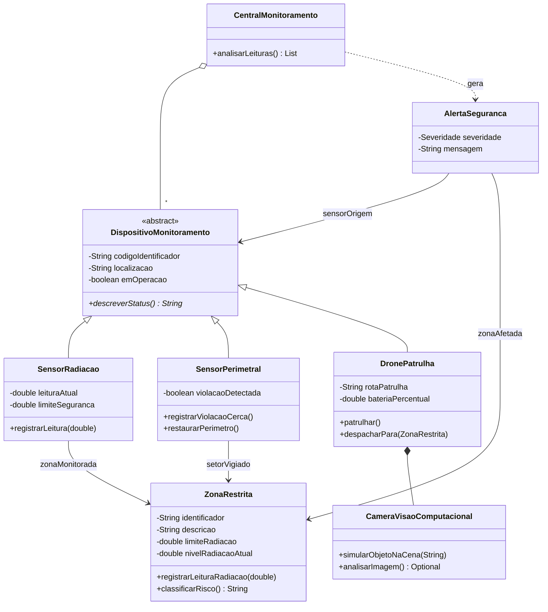
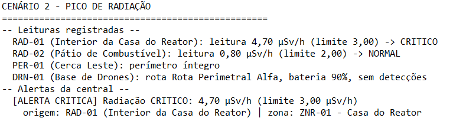
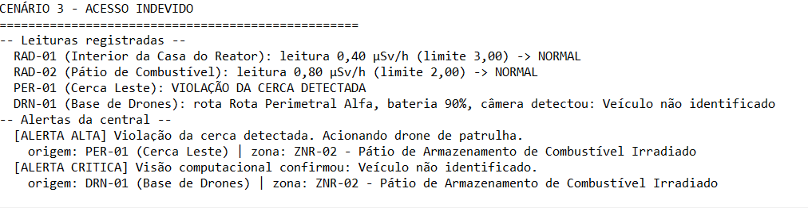

# 🛰️ SENTINELA — Sprint 1: O Domínio Base

> Protótipo em console (Java) que modela as zonas restritas de uma instalação nuclear fictícia, seus dispositivos de monitoramento (sensores e drone de patrulha) e a central que analisa as leituras e emite alertas classificados por severidade.


## 📋 Sumário
1. [Contexto](#-contexto)
2. [Modelo de domínio](#-modelo-de-domínio)
3. [Estrutura do projeto](#-estrutura-do-projeto)
4. [Como executar](#-como-executar)
5. [Cenários demonstrados](#-cenários-demonstrados)
6. [Testes](#-testes)
7. [Conceitos de POO aplicados](#-conceitos-de-poo-aplicados)
8. [Respostas de reflexão](#-respostas-de-reflexão)
9. [Decisões de projeto](#-decisões-de-projeto)
10. [Autores](#-autores)

## 🎯 Contexto
Instalações com reatores nucleares ou material radioativo exigem segurança física extremamente alta. O objetivo macro do **SENTINELA** é usar sensores, drones, visão computacional e IA para identificar, em tempo real, situações de risco, incluindo tentativas de acesso indevido.

Nesta **Sprint 1** o foco é o **domínio base**: classes, objetos, encapsulamento, construtores, associação e herança. A "IA" desta sprint é um **motor de regras** (`CentralMonitoramento.analisarLeituras()`), e a visão computacional é **simulada**.

## 🧩 Modelo de domínio



**Faixas de risco** (`ZonaRestrita.classificarRisco()`):

| Classificação | Condição | Severidade do alerta |
|---|---|---|
| `NORMAL` | nível < 50% do limite | — (sem alerta) |
| `ATENCAO` | 50% do limite ≤ nível < limite | `MEDIA` |
| `CRITICO` | nível ≥ limite | `CRITICA` |

Outras regras da central: violação de cerca → `ALTA`; objeto confirmado pela câmera do drone → `CRITICA`.

## 📁 Estrutura do projeto
```
sentinela/
├── src/sentinela/
│   ├── Main.java                      # executa os 3 cenários
│   ├── ZonaRestrita.java
│   ├── DispositivoMonitoramento.java  # superclasse
│   ├── SensorRadiacao.java
│   ├── SensorPerimetral.java
│   ├── DronePatrulha.java
│   ├── CameraVisaoComputacional.java
│   ├── AlertaSeguranca.java
│   ├── Severidade.java
│   ├── CentralMonitoramento.java      # motor de regras
│   └── ExecutarTestes.java            # testes sem dependências
├── test/sentinela/SentinelaTest.java  # testes JUnit 5 (opcional)
├── docs/                              # capturas e saídas reais
└── README.md
```

## ▶️ Como executar
**Requisito:** JDK 17 ou superior (`javac -version`).

```bash
# 1. compilar
javac -encoding UTF-8 -d out src/sentinela/*.java

# 2. executar os 3 cenários
java -cp out sentinela.Main

# 3. executar os testes
java -cp out sentinela.ExecutarTestes
```

> 💡 **Windows:** se acentos e `µ` aparecerem quebrados, rode `chcp 65001` no terminal antes de executar.

## 🎬 Cenários demonstrados

### Cenário 1 — Rotina normal
Leituras dentro dos limites, perímetro íntegro e drone em patrulha sem detecções. A central **não** emite alertas.


### Cenário 2 — Pico de radiação
A Casa do Reator (limite 3,00 µSv/h) recebe leitura de 4,70 µSv/h. A central aciona **alerta crítico**.



### Cenário 3 — Acesso indevido
O sensor perimetral detecta violação da cerca (alerta `ALTA`); o drone é despachado e a câmera simulada confirma um **veículo não identificado** (alerta `CRITICA`).



<details>
<summary>📄 Ver saída completa em texto</summary>

```text

==================================================
CENÁRIO 1 - ROTINA NORMAL
==================================================
-- Leituras registradas --
  RAD-01 (Interior da Casa do Reator): leitura 0,40 µSv/h (limite 3,00) -> NORMAL
  RAD-02 (Pátio de Combustível): leitura 0,80 µSv/h (limite 2,00) -> NORMAL
  PER-01 (Cerca Leste): perímetro íntegro
  DRN-01 (Base de Drones): rota Rota Perimetral Alfa, bateria 95%, sem detecções
-- Alertas da central --
  Nenhum alerta. Instalação em condição normal.

==================================================
CENÁRIO 2 - PICO DE RADIAÇÃO
==================================================
-- Leituras registradas --
  RAD-01 (Interior da Casa do Reator): leitura 4,70 µSv/h (limite 3,00) -> CRITICO
  RAD-02 (Pátio de Combustível): leitura 0,80 µSv/h (limite 2,00) -> NORMAL
  PER-01 (Cerca Leste): perímetro íntegro
  DRN-01 (Base de Drones): rota Rota Perimetral Alfa, bateria 90%, sem detecções
-- Alertas da central --
  [ALERTA CRITICA] Radiação CRITICO: 4,70 µSv/h (limite 3,00 µSv/h)
    origem: RAD-01 (Interior da Casa do Reator) | zona: ZNR-01 - Casa do Reator

==================================================
CENÁRIO 3 - ACESSO INDEVIDO
==================================================
-- Leituras registradas --
  RAD-01 (Interior da Casa do Reator): leitura 0,40 µSv/h (limite 3,00) -> NORMAL
  RAD-02 (Pátio de Combustível): leitura 0,80 µSv/h (limite 2,00) -> NORMAL
  PER-01 (Cerca Leste): VIOLAÇÃO DA CERCA DETECTADA
  DRN-01 (Base de Drones): rota Rota Perimetral Alfa, bateria 90%, câmera detectou: Veículo não identificado
-- Alertas da central --
  [ALERTA ALTA] Violação da cerca detectada. Acionando drone de patrulha.
    origem: PER-01 (Cerca Leste) | zona: ZNR-02 - Pátio de Armazenamento de Combustível Irradiado
  [ALERTA CRITICA] Visão computacional confirmou: Veículo não identificado.
    origem: DRN-01 (Base de Drones) | zona: ZNR-02 - Pátio de Armazenamento de Combustível Irradiado
```
</details>

## ✅ Testes
Os 7 testes cobrem os cenários sugeridos no enunciado. Podem ser executados **sem nenhuma biblioteca** (`ExecutarTestes`) ou com **JUnit 5** (`test/sentinela/SentinelaTest.java`).


| # | Teste | Conceito |
|---|---|---|
| 1 | Zona não é nula após instanciação | Classes e objetos |
| 2 | Leitura 0,2 → 4,7 µSv/h muda `NORMAL` para `CRITICO` | Métodos e comportamentos |
| 3 | Radiação `-5` é rejeitada e mantém o último valor válido | Encapsulamento |
| 4 | Leitura acima de 1.000.000 µSv/h é rejeitada (falha de sensor) | Encapsulamento |
| 5 | Identificador vazio `""` é rejeitado | Construtores |
| 6 | `alerta.getSensorOrigem()` é o mesmo objeto (`==`) do sensor | Associação |
| 7 | As três filhas herdam `getCodigoIdentificador()` | Herança |

## 🧠 Conceitos de POO aplicados
| Conceito | Onde aparece |
|---|---|
| **Classe × objeto** | `ZonaRestrita` e as instâncias `ZNR-01` e `ZNR-02` no `Main` |
| **Métodos de domínio** | `registrarLeituraRadiacao()`, `classificarRisco()` |
| **Encapsulamento** | atributos `private`; setter só valida e atribui |
| **Construtores** | `ZonaRestrita(identificador, descricao, limiteRadiacao)`, sem construtor padrão |
| **Associação (TEM-UM)** | `AlertaSeguranca` → sensor e zona; `CentralMonitoramento` → dispositivos; drone → câmera |
| **Herança (É-UM)** | `SensorRadiacao`, `SensorPerimetral` e `DronePatrulha` estendem `DispositivoMonitoramento` via `super()` |
| **Polimorfismo** | array `DispositivoMonitoramento[]` e `descreverStatus()` |

## 💭 Respostas de reflexão
**Por que `ZonaRestrita` é uma classe e "ZNR-01 - Casa do Reator" é um objeto?**
A classe é o molde: define o que toda zona possui e faz. O objeto é uma instância concreta, com estado próprio. Há uma classe, mas podem existir muitos objetos.

**Por que a regra de risco mora em `ZonaRestrita` e não em `if`s no `main`?**
Porque a zona conhece seu limite e seu nível (coesão). Espalhada pelo `main`, a regra seria duplicada, poderia ficar inconsistente e mudá-la exigiria caçar código em vários lugares.

**Se `nivelRadiacaoAtual` fosse público, que fraude seria possível?**
Qualquer código poderia gravar valores impossíveis (negativos, 1e9) ou "zerar" um pico crítico antes do relatório, falsificando o histórico da central sem validação nem rastro.

**Por que o construtor padrão desaparecer protege o cadastro de zonas?**
Ao definir um construtor customizado, o Java não gera o padrão. Assim `new ZonaRestrita()` não compila e é impossível criar uma "zona fantasma" sem identificador, descrição e limite válidos.

**O que a central perderia se o alerta guardasse só a `String` do código do sensor?**
Perderia o acesso à localização, ao estado do sensor e à zona afetada (nível, limite, risco), precisando procurar tudo de novo para escalonar o incidente. Com a referência ao objeto, tudo está a um `get` de distância.

**Por que a filha deve passar o código por `super()` e não fazer `this.codigoIdentificador = ...`?**
O atributo é `private` na mãe (**encapsulamento**): só ela decide como validar e atribuir. O `super()` garante que a validação sempre execute, e a filha não pode contorná-la.

## 🛠️ Decisões de projeto
- **Regra dos 3 parâmetros:** `AlertaSeguranca` recebe a mensagem por `comMensagem(...)`, mantendo o construtor com 3 parâmetros.
- **Limite do sensor:** `SensorRadiacao` obtém `limiteSeguranca` da zona monitorada, evitando um 4º parâmetro e a duplicação do limite.
- **Sem herança gulosa:** o drone *tem uma* câmera (associação); não herda de sensor.
- **Setor vigiado:** `SensorPerimetral.setorVigiado` é uma `ZonaRestrita`, para o alerta de violação ter uma zona afetada.
- **Limites fictícios:** 3,0 µSv/h (reator) e 2,0 µSv/h (pátio), usados apenas para a demonstração.
- **Testes sem dependências:** `ExecutarTestes` roda em qualquer máquina com JDK, sem Maven, Gradle ou JUnit.

## 👥 Autores
| Nome | RM |
|---|---|
| _Seu nome_ | _seu RM_ |

**Disciplina:** _nome da disciplina_ — **Turma:** 2CCP — **Challenge Sprint 1**

